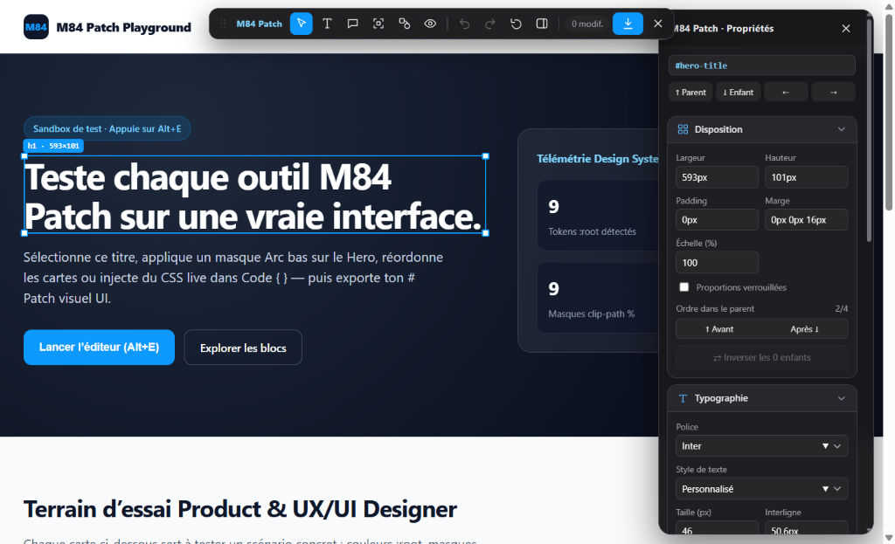
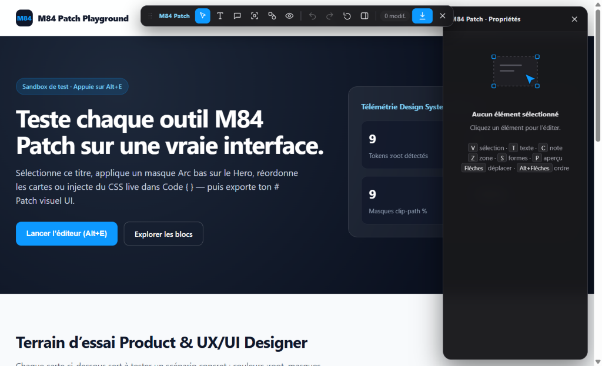

# M84 Patch

> **Open-Source Visual UI Editor & AI Patch Engine for Product Designers, UX/UI Designers & Vibecoders** — *Point. Tweak. Copy `# Visual UI Patch`. Zero inline CSS.*
>
> **Live Site**: [m84patch.vercel.app](https://m84patch.vercel.app) · **Live Playground**: [m84patch.vercel.app/demo](https://m84patch.vercel.app/demo) · **License**: MIT · **Created by**: [Moslih84](https://moslih84.vercel.app)



---

## Works with ALL AI Tools

**M84 Patch** exports a clean, structured `# Visual UI Patch` prompt compatible with **any AI coding assistant**:
- **ChatGPT (GPT-4o / o3 / Codex)**
- **Claude (Claude.ai, Claude Code, HTML Artifacts)**
- **Google Antigravity (global Skill included)**
- **Cursor · Windsurf · GitHub Copilot · Gemini · v0 · Bolt · Lovable · etc.**

---

## Why M84 Patch?

Describing visual UI tweaks in plain text to an LLM (*"nudge this button up, add a bottom arc to the hero, swap these two cards, apply the primary design-system token"*) burns 10 back-and-forth prompts.

**M84 Patch** injects a Figma-like visual editor (isolated inside a **Shadow DOM**, zero external dependencies) directly onto your **`localhost`** (Next.js, Vite, React, HTML), any **staging/live site**, or a **standalone HTML artifact**. In 1 click, it copies a structured **`# Visual UI Patch`** that your AI applies cleanly to your CSS, Tailwind classes, and `:root` tokens (**zero inline `style=""`**, 8 px grid, WCAG 2.1 AA, role-based unification).

---

## Key Features (v2.0)

| Category | Capabilities |
| :--- | :--- |
| **Shadow DOM Isolation** | Editor UI never collides with Tailwind, Next.js, or production stylesheets. |
| **Inspection & Layout** | Visual picking, DOM navigation (`Parent / Child / ← / →`), aspect-ratio lock, numeric scrub (`Shift = ×10`), DOM reordering (`Before/After`, `Reverse`, `Alt+Arrows`). |
| **`:root` Tokens & Gradients** | Auto-reads `:root` CSS variables as clickable swatches + custom solid/gradient fills (background & text) saved locally. |
| **Shapes & Masks (`S`)** | 9 responsive `%` `clip-path` presets (`Bottom Arc`, `Diagonal`, `Chevron`, `Circle`, `Pill`, `Hexagon`, `Diamond`, `Bevel`, `Blob`) + drawn shapes (`Frame`, `Arrow`, `Line`, `Ellipse`) with **`Guide` / `Real`** toggle. |
| **Code Block `{ }`** | Live element-scoped CSS + JS/Animation spec exported with `prefers-reduced-motion` reminder (zero `eval`, 100% MV3 & CSP compliant). |
| **Annotations & Zones (`C` / `Z`)** | Element-anchored notes or multi-element lasso `Zone (Z)` notes, with clipboard image paste (`Ctrl+V`). |
| **Preview & Transactional Undo** | Preview mode (`P` or hold `Space`) to test links/hovers without closing the editor; transactional `Ctrl+Z` / `Ctrl+Shift+Z` across all actions. |

---

## 4-Step Overview

| 1. Open M84 Patch (`Alt+E`) | 2. Pick & inspect `:root` tokens |
| :---: | :---: |
|  |  |
| **3. `clip-path` Masks & Shapes (`S`)** | **4. Copy `# Visual UI Patch` to GPT / Claude / Antigravity** |
|  |  |

---

## Installation

### 1. Chrome Extension Manifest V3 (`localhost` + live/staging sites)
1. Download **[m84-patch-chrome-extension.zip](https://m84patch.vercel.app/downloads/m84-patch-chrome-extension.zip)** and unzip it (or use `dist/chrome-extension/` from this repo).
2. Open `chrome://extensions` in Chrome / Brave / Edge / Arc.
3. Enable **Developer mode** (top right) → click **Load unpacked** → select the unzipped folder.
4. Press **`Alt+E`** or click the **M84 Patch** toolbar icon on any tab.

### 2. Claude.ai / Antigravity Skill (HTML artifacts)
- **Direct download**: **[m84-patch-skill.zip](https://m84patch.vercel.app/downloads/m84-patch-skill.zip)** (`SKILL.md` + `m84-patch.html`).
- **Claude.ai**: upload `m84-patch-skill.zip` in Skills.
- **Antigravity**: the build script automatically syncs `~/.gemini/config/skills/m84-patch/SKILL.md`.

### 3. Local Build (zero npm dependencies)
```bash
npm run build
```

---

## Author & License

- **Created by [Moslih84](https://moslih84.vercel.app)** (Ayoub Moslih — Product & UX/UI Designer)
- **Official Website**: [https://m84patch.vercel.app](https://m84patch.vercel.app)
- **License**: [MIT](LICENSE) — Free to use, modify, and share.
