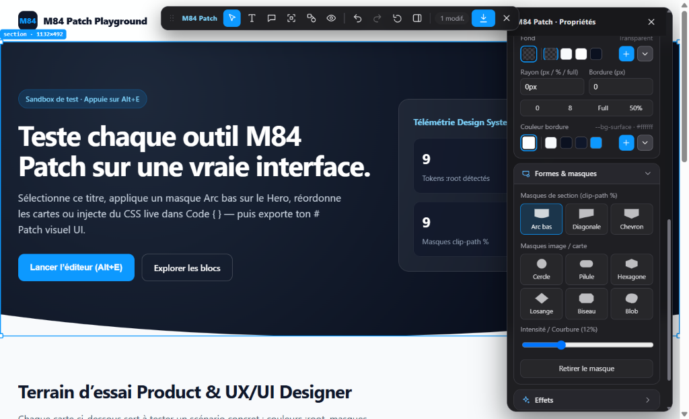
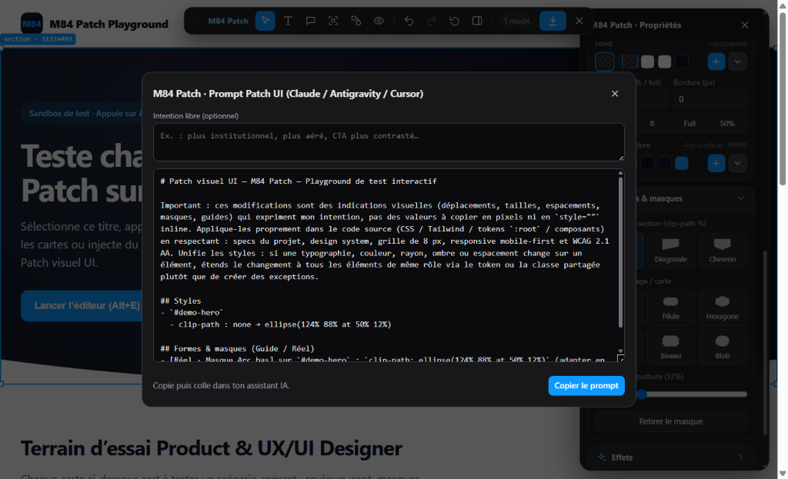

# M84 Patch

> **Open-Source Visual UI Editor & AI Patch Engine for Product & UX/UI Designers** — *Point. Tweak. Copy `# Patch visuel UI`. Zero inline CSS.*
>
> **Live Site** : [m84-patch.vercel.app](https://m84-patch.vercel.app) · **Live Playground** : [m84-patch.vercel.app/demo.html](https://m84-patch.vercel.app/demo.html) · **Licence** : MIT · **Créé par** : [Moslih84](https://moslih84.com)


---

## Compatible avec TOUS les outils IA

**M84 Patch** génère un prompt `# Patch visuel UI` universel et structuré qui fonctionne avec **n'importe quel assistant IA** :
- **ChatGPT (GPT-4o / o3 / Codex)**
- **Claude (Claude.ai, Claude Code, Artefacts HTML)**
- **Google Antigravity (Skill global inclus)**
- **Cursor · Windsurf · GitHub Copilot · Gemini · v0 · Bolt · Lovable · etc.**

---

## Pourquoi M84 Patch ?

Décrire des retouches UI en texte pur à un LLM (*« remonte un peu le bouton, arrondis le bas du hero en arc, échange ces deux cartes, mets la couleur primaire du design system »*) consomme 10 allers-retours.

**M84 Patch** injecte un éditeur visuel type Figma (isolé dans un **Shadow DOM**, zéro dépendance externe) directement sur ton **`localhost`** (Next.js, Vite, React, HTML), sur un **site live/staging**, ou dans un **artefact HTML**. En 1 clic, il exporte un **`# Patch visuel UI`** que ton IA applique proprement dans le CSS, Tailwind et les tokens `:root` (**zéro `style=""` inline**, grille 8 px, WCAG 2.1 AA, unification par rôle).

---

## Fonctionnalités clés (v2.0)

| Catégorie | Capacités |
| :--- | :--- |
| **Isolation Shadow DOM** | L'UI de l'éditeur ne casse jamais Tailwind, Next.js ou le CSS d'un site en production. |
| **Inspection & Layout** | Sélection visuelle, navigation DOM (`Parent / Enfant / ← / →`), redimensionnement verrouillé, scrub numérique (`Maj = ×10`), réordonnancement DOM (`Avant/Après`, `Inverser`, `Alt+Flèches`). |
| **Tokens `:root` & Dégradés** | Lecture automatique des variables CSS `:root` en pastilles cliquables + création de couleurs unies ou dégradés (fond et texte) sauvegardés localement. |
| **Formes & Masques (`S`)** | 9 presets `clip-path` responsives en `%` (`Arc bas`, `Diagonale`, `Chevron`, `Cercle`, `Pilule`, `Hexagone`, `Losange`, `Biseau`, `Blob`) + formes dessinées (`Cadre`, `Flèche`, `Ligne`, `Ellipse`) avec bascule **`Guide` / `Réel`**. |
| **Bloc Code `{ }`** | CSS live scopé à l'élément + spécification JS/Animation exportée avec rappel `prefers-reduced-motion` (sans `eval`, 100 % compatible MV3 & CSP). |
| **Annotations & Zones (`C` / `Z`)** | Notes ancrées à un élément ou groupées par lasso `Zone (Z)`, avec collage d'images (`Ctrl+V`). |
| **Aperçu & Undo transactionnel** | Mode Aperçu (`P` ou maintenir `Espace`) pour tester les liens/hovers sans fermer l'éditeur ; `Ctrl+Z` / `Ctrl+Maj+Z` transactionnel sur toutes les actions. |

---

## Aperçu en 4 étapes

| 1. Ouvrir M84 Patch (`Alt+E`) | 2. Sélectionner & inspecter `:root` |
| :---: | :---: |
|  |  |
| **3. Masques `clip-path` & Formes (`S`)** | **4. Copier `# Patch visuel UI` vers GPT / Claude / Antigravity** |
|  |  |

---

## Installation

### 1. Extension Chrome Manifest V3 (`localhost` + sites live/prod)
1. Clone le repo ou télécharge le dossier `dist/chrome-extension/`.
2. Ouvre `chrome://extensions` dans Chrome / Brave / Edge.
3. Active **Mode développeur** → **Charger l'extension non empaquetée** → sélectionne `dist/chrome-extension/`.
4. Appuie sur **`Alt+E`** ou clique l'icône **M84 Patch** sur n'importe quel onglet.

### 2. Skill Claude.ai / Antigravity (artefacts HTML)
- **Claude.ai** : importe `dist/claude-skill/m84-patch-skill.zip` (`SKILL.md` + `m84-patch.html`).
- **Antigravity** : le build synchronise automatiquement `~/.gemini/config/skills/m84-patch/SKILL.md`.

### 3. Build local (zéro dépendance npm)
```bash
npm run build
```

---

## Auteur & Licence

- **Créé par [Moslih84](https://moslih84.com)** (Ayoub Moslih — Product & UX/UI Designer)
- **Site officiel** : [https://m84-patch.vercel.app](https://m84-patch.vercel.app)
- **Licence** : [MIT](LICENSE) — Libre d'utilisation, modification et partage.
